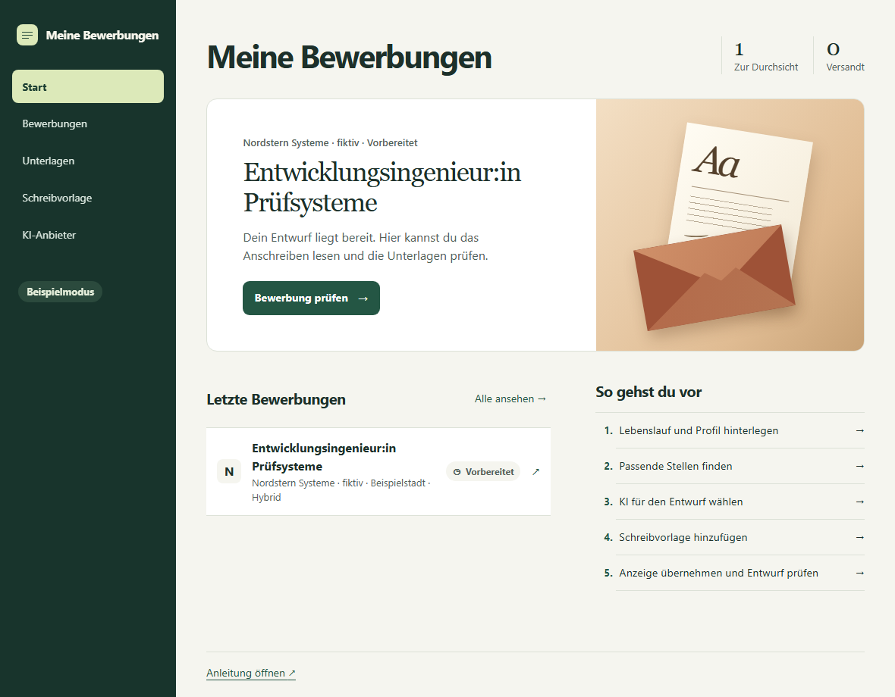

# Meine Bewerbungen

Finde Stellen, die zu deinem Lebenslauf passen. Lies zu jedem Vorschlag, welche Erfahrung dafür spricht. Anschreiben, Belege, Antworten und PDFs stehen pro Stelle zusammen in deinem lokalen Arbeitsbereich.

## Im Chat starten

Teile den **[Installationslink](INSTALL.md)** mit einem lokalen Codex- oder Claude-Code-Chat und schreibe „Installiere diese App und öffne sie im Browser.“ Der Chat klont das Projekt und führt das Setup aus. Die vier Rollen sind enthalten. Für die erste Suche genügt ein lesbarer Lebenslauf als PDF. Die persönliche Anmeldung und Zugriffsfreigaben erfolgen bei Bedarf im jeweiligen Client.

**[Bebilderte Anleitung öffnen](docs/ANLEITUNG.md)** · [Arbeitsweise und Datenschutz](docs/WORKFLOW.md)

## Von der Suche zur Bewerbung

1. **Lebenslauf hinzufügen.** Die PDF bleibt im privaten Datenordner des Betriebssystemkontos. Der Abgleich verwendet ausschließlich den Lebenslauf der jeweiligen Person. Ort und Stichwörter können die Suche einschränken.
2. **Stellen finden.** Die App lädt öffentliche Stellen von Greenhouse-Firmenportalen, Ashby, Lever und Arbeitnow. Für weitere Jobbörsen und Unternehmensseiten kannst du eine Webrecherche im Projektchat starten. Dafür werden nur die abgeleiteten Fachgebiete und der eingegebene Suchort übergeben. Die Reichweite hängt von öffentlich zugänglichen Anzeigen und den Webwerkzeugen des Clients ab.
3. **Entwurf lesen.** Der Schreibagent verknüpft Aufgaben der Anzeige mit belegten Erfahrungen. Ein früheres Anschreiben kann den Stil vorgeben. Ein zweiter Agent prüft die Aussagen. Für diese beiden Schritte verarbeitet der gewählte Anbieter die freigegebenen Texte.
4. **Über den Versand entscheiden.** Bei unterstützten Greenhouse-Formularen prüfst du Antworten, Anschreiben und Anlagen und gibst diese Fassung frei. Bei anderen Portalen erhältst du den Entwurf und öffnest die Originalanzeige für die persönliche Einreichung.

## Modellwahl und Kontingent

| Rolle | Codex | Claude Code | Einsatz |
| --- | --- | --- | --- |
| Recherche | GPT-6 Luna · hoch | Haiku · hoch | Öffentliche Webrecherche im Projektchat. Der normale Quellenabruf und der Lebenslaufabgleich laufen lokal ohne Modell. |
| Anschreiben | GPT-6.2 Sol · mittel | Haiku · hoch | Ein Entwurf für eine ausgewählte Stelle mit Belegstellen. |
| Faktenprüfung | GPT-6.2 Sol · mittel | Sonnet · mittel | Eigener Durchgang für Qualifikationen, Zeiträume und Formularantworten. |
| Portal | GPT-6 Luna · hoch | Haiku · hoch | Nur bei Erläuterungen im Chat. Das freigegebene Formular füllt die App ohne Modell aus. |

Die Modellwahl ist auf kurze, getrennte Aufgaben abgestimmt. Lokale Suche und Portalversand verbrauchen keine Modelltokens. Die Webrecherche liefert bis zu zehn geprüfte Vorschläge je Auftrag. Für den Entwurf wird nur die ausgewählte Anzeige übergeben.

Claude Pro enthält Claude Code und kostet bei monatlicher Zahlung laut Anbieter 20 US-Dollar vor anwendbaren Steuern. Es gelten Nutzungsgrenzen. Die Aliase `haiku` und `sonnet` richten sich nach dem lokal verfügbaren Modell. Eine feste Zahl an Bewerbungen lässt sich aus dem Tarif nicht ableiten. [Claude-Tarife](https://claude.com/pricing) · [Modelle und Reasoning](https://code.claude.com/docs/en/model-config) · [Codex mit ChatGPT](https://help.openai.com/en/articles/11369540-using-codex-with-your-chatgpt-plan)

## Ausprobieren und prüfen

Der Beispielmodus verwendet fiktive Personen und ein lokales Testportal. Die Anleitung zeigt diesen Ablauf bis zur Quittung. Für Entwicklungstests mit Node.js 24 oder neuer: `npm ci`, `npx playwright install chromium`, `npm test`. Der Windows-Start und der lokale Testversand sind geprüft. Der Systemstart auf macOS und Linux sowie echte Portalübermittlungen sind unbestätigt.

Bei Änderungen an der Oberfläche erzeugt `node tools/capture-guide.mjs` die Screenshots in einer temporären Installation mit fiktiven Daten. Die GitHub-Anleitung ist die Textquelle für die Offline-Hilfe. Nach dem Bearbeiten von [docs/ANLEITUNG.md](docs/ANLEITUNG.md) aktualisiert `pwsh -File tools/build-guide.ps1` die fertige HTML-Datei. Die installierte App kann sie direkt öffnen.
