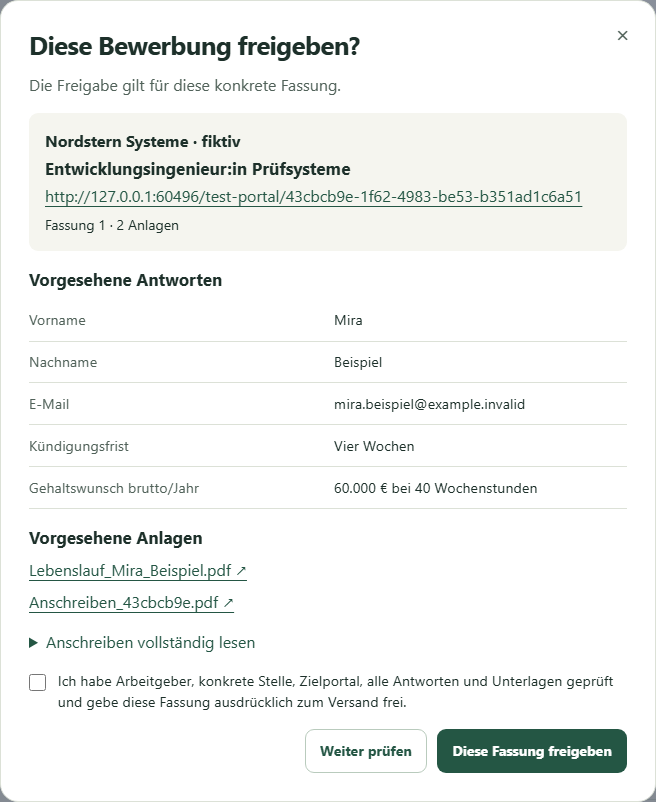

# Anleitung

## Über einen Chat installieren

Teile im lokalen Codex- oder Claude-Code-Chat den [Installationslink](../INSTALL.md) mit dem Satz „Installiere diese App und öffne sie im Browser.“ Das Setup richtet die App im Benutzerkonto ein. Der Browser öffnet deinen persönlichen Arbeitsbereich. Du kannst auch das Projekt-ZIP entpacken und die Startdatei öffnen.

Über **Lebenslauf hinzufügen** wählst du eine textlesbare PDF. Unter **Bewerbungen → Stellen nach Lebenslauf suchen** beginnt die Suche. Name, E-Mail oder ein KI-Konto brauchst du erst beim Vorbereiten eines Entwurfs.

## Den KI-Anbieter verbinden

Die Demo funktioniert sofort mit fiktiven Daten. Die Anbieterwahl findest du unter **KI-Anbieter**. Bei der Chat-Installation legt der Starter den passenden Client für einen neuen Arbeitsbereich fest.

### Mit ChatGPT

1. Klicke bei Bedarf auf **Codex installieren**.
2. Wähle **Bei ChatGPT anmelden**. Codex öffnet die offizielle Anmeldeseite.
3. Kehre zur App zurück und klicke auf **Anmeldestatus prüfen**. Unter **Angemeldet** kannst du mit **Weiter zu Unterlagen** fortfahren.
4. Beim ersten Entwurf nutzt die App den lokal angemeldeten Codex-Client mit dem Kontingent dieses ChatGPT-Kontos. [Codex-Anmeldung](https://learn.chatgpt.com/docs/auth)

### Mit Claude Code

1. Nutze den Projektchat in **Claude Code** mit deinem eigenen Claude-Konto.
2. Wähle in der Browser-App **Claude verwenden**.
3. Öffne eine Stelle im Browser, bestätige die Angaben für die Entwurfserstellung und wähle **Auftrag für Claude Code erstellen**.
4. Starte im Claude-Code-Chat `/meine-bewerbungen`. Claude Code erstellt und prüft den Entwurf mit dem dort angemeldeten Konto. Die Browser-App übernimmt das Ergebnis. [Claude Code einrichten](https://code.claude.com/docs/en/setup)

## Unterlagen und Stellen

1. Hinterlege unter **Unterlagen** den Lebenslauf als PDF und speichere Namen und E-Mail im Profil.
2. Lege in **Schreibvorlage** ein früheres Anschreiben über **Muster-PDF auswählen** ab. Ohne PDF kannst du **Ich habe kein Musteranschreiben** öffnen und drei Fragen beantworten.
3. Starte unter **Bewerbungen** die Suche über **Stellen nach Lebenslauf suchen** oder füge einen direkten Link zu einer Greenhouse-Stelle ein.
4. Wähle einen Treffer aus. Die App verwendet die Anzeige, um relevante, belegte Erfahrungen aus deinem Lebenslauf herauszugreifen. Ein zweiter Agent prüft den Entwurf und die Formularantworten.

**Weitere Jobbörsen:** Öffne **Weitere Jobbörsen und Karriereseiten durchsuchen → Webrecherche starten**. Lass den Projektchat geöffnet. Falls er gerade wartet, starte den Projekt-Skill in Codex oder Claude Code. Der Agent prüft öffentlich erreichbare Einzelanzeigen und die App gleicht die Treffer lokal mit deinem Lebenslauf ab. Bei **Persönlicher Versand** kannst du den Entwurf erstellen und die Unterlagen selbst bei der Firma einreichen.

## Prüfen und versenden

Lies Anschreiben und Antworten. Öffne beide PDFs. Prüfe Firma, Stelle und Zielportal und klicke auf **Prüfen & freigeben**. Danach löst **Freigegebene Bewerbung absenden** das Ausfüllen und Absenden im Portal aus. Bei **Ausgang unklar** prüfst du den Eingang am Portal oder im Postfach.

Beim Entwurf verarbeitet der gewählte Anbieter Text aus den freigegebenen Unterlagen. Passwörter und Anmeldedaten bleiben beim Anbieter. Die App versendet die Bewerbungsunterlagen mit der Freigabe der konkreten Fassung.

[Modelle und Reasoning je Rolle](../README.md#modellwahl-und-kontingent) · [Zur Projektübersicht](../README.md)
