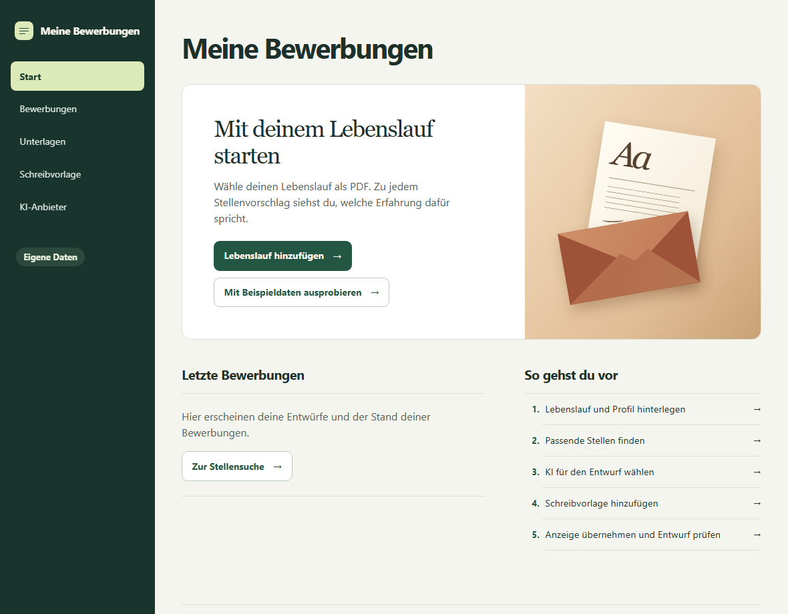
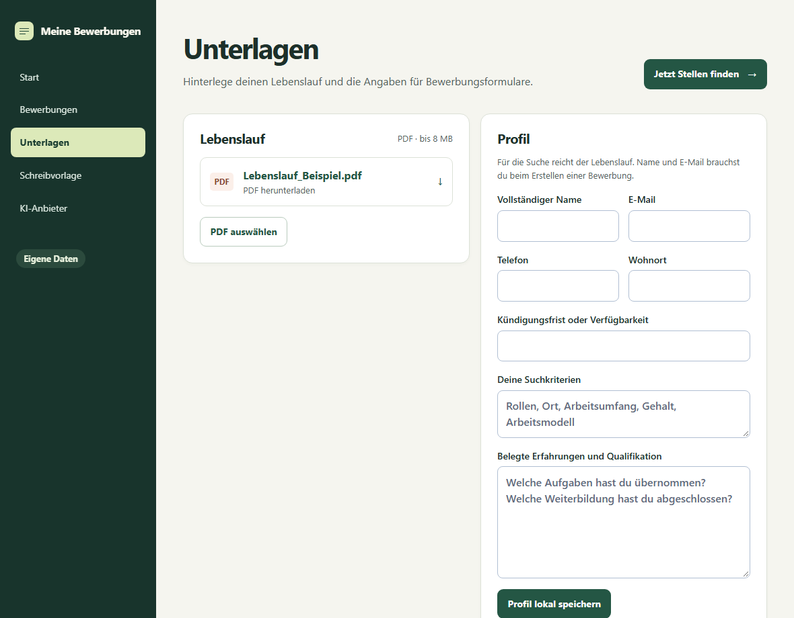
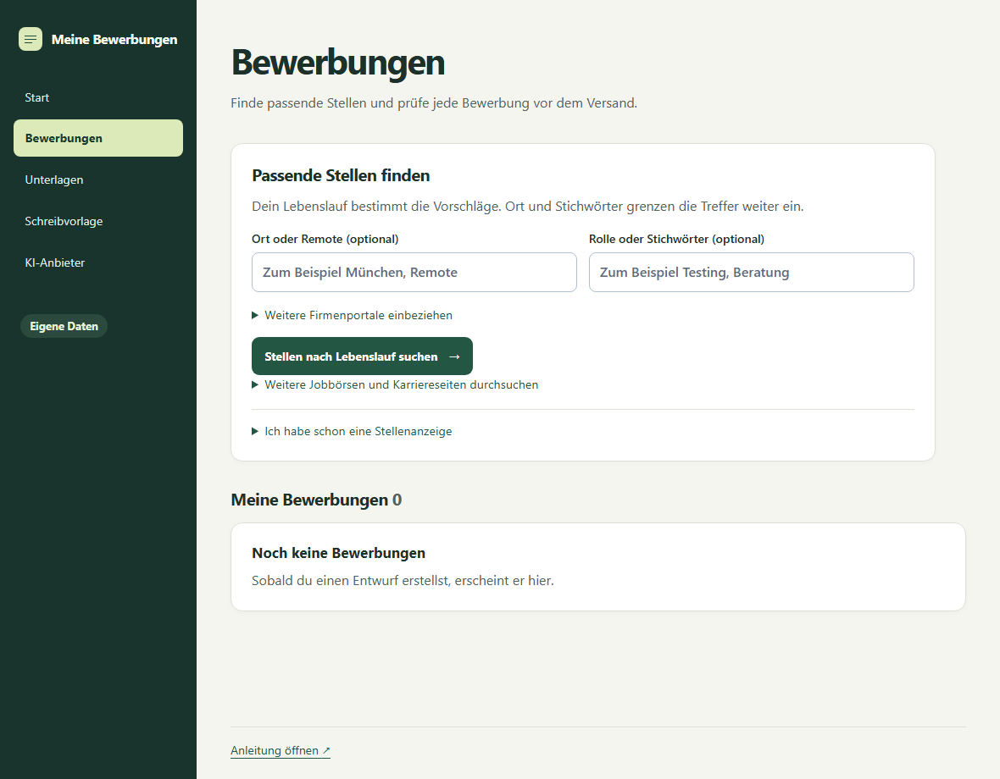
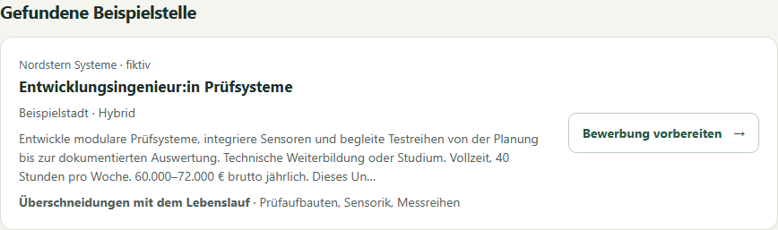
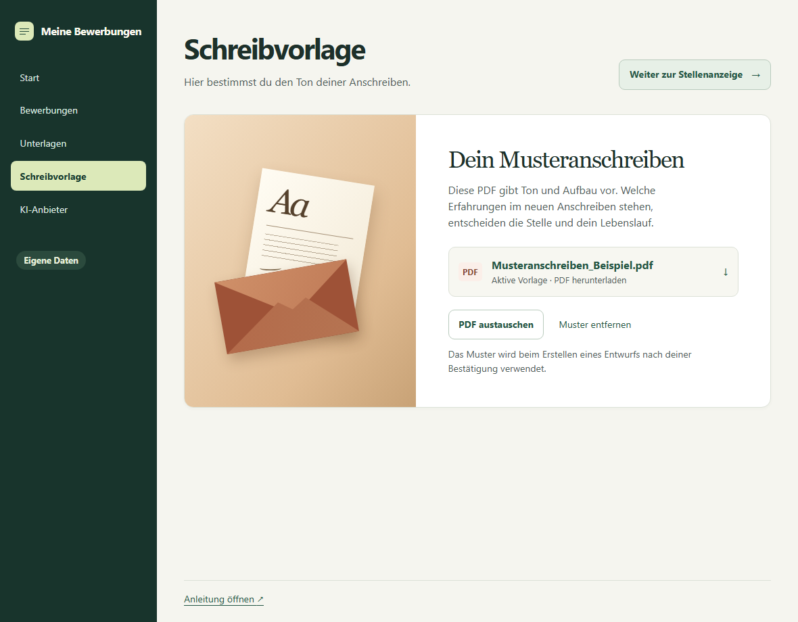
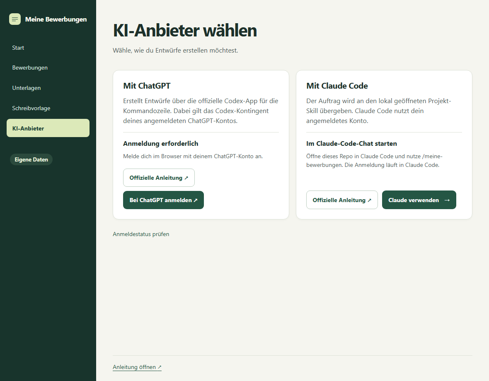
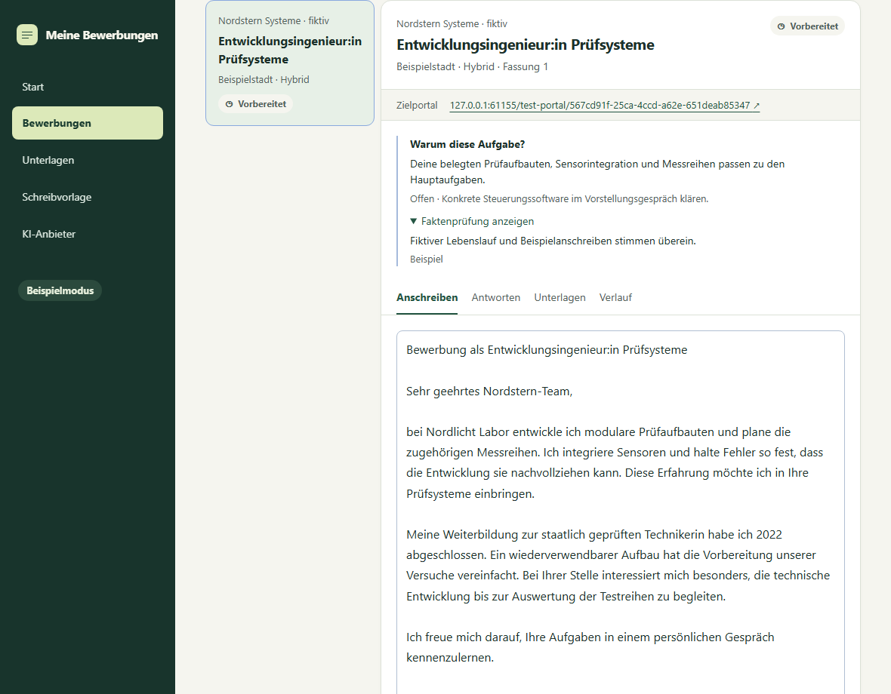
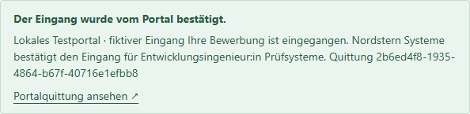

# Anleitung

Vom ersten Start bis zur geprüften Bewerbung. Am Computer wechselst du links zwischen den Bereichen. Auf kleinen Bildschirmen öffnest du sie über **Menü**. **Eigene Daten** und **Beispielmodus** zeigen dir, in welchem Arbeitsbereich du bist. Alle Bilder in dieser Anleitung stammen aus einer getrennten Installation mit fiktiven Daten.

## Im Chat installieren

Teile die [Installationsseite](../INSTALL.md) mit einem lokalen Codex- oder Claude-Code-Chat und schreibe „Installiere diese App und öffne sie im Browser.“ Der Chat richtet das Projekt und seine vier Rollen ein. Falls dein Client nach einer Anmeldung oder dem Zugriff auf den Projektordner fragt, bestätigst du das selbst.

Du kannst das Projekt auch als ZIP entpacken und **Start Windows** oder **Start macOS** öffnen. Beim ersten Start braucht das Setup Internet. Ein weiterer Start öffnet die laufende App erneut. Die Anleitung lässt sich auch bei geschlossener App als **web/anleitung.html** öffnen.

## Den Lebenslauf hinterlegen

1. Klicke auf der Startseite auf **Lebenslauf hinzufügen**. Unter **Unterlagen → PDF auswählen** wählst du deinen Lebenslauf. Verwende eine PDF mit auswählbarem Text, ohne Passwort, bis 8 MB.
2. Sobald der Dateiname erscheint, kannst du **Jetzt Stellen finden** wählen. Für die Suche genügt der Lebenslauf.
3. Für einen Entwurf trägst du unter **Profil** mindestens deinen Namen und deine E-Mail ein und klickst auf **Profil lokal speichern**. Hier kannst du auch Verfügbarkeit, belegte Erfahrung und Wünsche für deine Bewerbung ergänzen.

## Passende Stellen finden

Unter **Bewerbungen** startet **Stellen nach Lebenslauf suchen** die lokale Suche. Die App lädt öffentliche Anzeigen von Greenhouse-Firmenportalen, Arbeitnow, Lever und Ashby. Ort und Stichwörter grenzen die Treffer weiter ein. Über **Ich habe schon eine Stellenanzeige** kannst du den direkten Link zu einer einzelnen Greenhouse-Stelle prüfen.

Für zusätzliche Quellen öffnest du **Weitere Jobbörsen und Karriereseiten durchsuchen** und wählst **Webrecherche starten**. Der Projektchat erhält Fachgebiete aus deinem Lebenslauf und den eingegebenen Suchort. Lass ihn nach öffentlich erreichbaren Einzelanzeigen suchen, etwa auf Stepstone, Indeed, LinkedIn oder Unternehmensseiten. Falls der Chat auf deinen Auftrag wartet, starte dort den Projekt-Skill `$meine-bewerbungen` in Codex oder `/meine-bewerbungen` in Claude Code. Die App prüft die zurückgegebenen Treffer lokal gegen deinen Lebenslauf.

Lies bei jedem Vorschlag Firma, Aufgaben und Überschneidungen mit deinem Lebenslauf. **Originalanzeige öffnen** führt zur Quelle. **Portalversand verfügbar** kennzeichnet ein unterstütztes Greenhouse-Ziel. Bei **Persönlicher Versand** kannst du den Entwurf vorbereiten und selbst beim Arbeitgeber einreichen.

## Eine Schreibvorlage wählen

Öffne **Schreibvorlage → Muster-PDF auswählen**. Nimm ein früheres Anschreiben, dessen Ton zu dir passt. Der Dateiname und **Aktive Vorlage · PDF herunterladen** zeigen, welches Muster für neue Entwürfe gilt. Mit **PDF austauschen** wechselst du die Vorlage.

Hast du kein Muster, kannst du **Ich habe kein Musteranschreiben** öffnen. Drei Fragen helfen dir, eigene Schreibhinweise zu formulieren. Sobald eine PDF aktiv ist, verschwinden diese Fragen. Die Vorlage ist optional. Die fachlichen Aussagen im Anschreiben müssen durch deinen Lebenslauf oder deine bestätigten Angaben belegt sein.

## Den KI-Anbieter verbinden

Der Chat-Starter wählt bei einem neuen Arbeitsbereich den verwendeten Client. Unter **KI-Anbieter** kannst du die Auswahl prüfen oder ändern.

- **Codex mit ChatGPT.** Falls nötig wählst du **Codex installieren**, dann **Bei ChatGPT anmelden**. Nach der offiziellen Anmeldung klickst du auf **Anmeldestatus prüfen**. Wähle **ChatGPT verwenden** oder, beim bereits ausgewählten Anbieter, **Weiter zu Unterlagen**.
- **Claude Code.** Verwende den lokal geöffneten Projektchat mit deinem angemeldeten Claude-Konto. Wähle in der App **Claude verwenden** oder **Weiter zu Unterlagen**. Sobald du einen Entwurf beauftragst, verarbeitet der Projektchat die dafür freigegebenen Daten.

| Rolle | Codex | Claude Code |
| --- | --- | --- |
| Webrecherche | GPT-6 Luna · hoch | Haiku · hoch |
| Anschreiben | GPT-6.2 Sol · mittel | Haiku · hoch |
| Faktenprüfung | GPT-6.2 Sol · mittel | Sonnet · mittel |
| Portalfragen im Chat | GPT-6 Luna · hoch | Haiku · hoch |

Die gewöhnliche Quellensuche, der lokale Abgleich und der freigegebene Formularversand laufen ohne Modell. Für Webrecherche und Entwürfe gilt das Kontingent des jeweiligen Clients.

## Einen Entwurf prüfen

1. Wähle beim Treffer **Bewerbung vorbereiten**. Lies, welche Angaben der Anbieter verarbeiten soll, und bestätige die Erstellung. Bei Codex klickst du auf **Entwurf mit ChatGPT erstellen**. Bei Claude wählst du **Auftrag für Claude Code erstellen** und startest im Projektchat `/meine-bewerbungen`. Die App übernimmt den geprüften Entwurf.
2. Auf der Startseite öffnet **Bewerbung prüfen** den angezeigten Entwurf. Unter **Bewerbungen** findest du alle vorbereiteten Stellen. Öffne **Faktenprüfung anzeigen**, um das Ergebnis der unabhängigen Prüfung zu lesen.
3. Prüfe **Anschreiben**, **Antworten**, **Unterlagen** und **Zielportal**. Speichere Textänderungen mit **Text & PDF speichern** und geänderte Formularangaben mit **Antworten speichern**. Eine Änderung hebt eine bestehende Freigabe auf.

## Freigeben und versenden

Beim unterstützten Portal klickst du auf **Prüfen & freigeben**. Im Dialog siehst du die konkrete Stelle, Antworten und Dateien. Öffne beide PDFs. Wenn alles stimmt, setze das Häkchen und wähle **Diese Fassung freigeben**. Erst **Freigegebene Bewerbung absenden** löst den Portalversand aus.

Bei **Bestätigt versandt** kannst du die Portalquittung öffnen. Bei **Angehalten** liest du den Grund im Entwurf. Bei **Ausgang unklar** prüfst du den Eingang im Portal oder Postfach. Die App löst in diesem Zustand keinen zweiten Versuch aus.

## Ausprobieren, exportieren und Hilfe finden

- **Beispielmodus.** Wähle auf der persönlichen Startseite **Mit Beispieldaten ausprobieren**. Im Beispielbereich lädst du über die gleichnamige Schaltfläche die fiktiven Daten und wählst **Beispielstelle suchen**. Hier kannst du den gesamten Weg bis zur simulierten Quittung ausprobieren.
- **Übersicht mitnehmen.** Unter **Bewerbungen → Übersicht als HTML speichern** erhältst du eine offline lesbare Momentaufnahme mit Firma, Stelle und Status. Ein neuer Export erfasst spätere Änderungen.
- **Anmeldung oder Kontingent.** Prüfe den Status im gewählten Client. Für einen gescannten Lebenslauf exportiere eine PDF mit Text oder führe vorher eine Texterkennung durch. Muss ein Portal eine zusätzliche Einwilligung, Anmeldung oder ein CAPTCHA prüfen, steht der Grund in der Bewerbung.

Originaldokumente und Verlauf liegen im lokalen Datenordner deines Betriebssystemkontos. Beim Erstellen eines Entwurfs verarbeitet der gewählte Anbieter die freigegebenen Texte. Die PDFs gehen beim freigegebenen Versand an das Portal.
